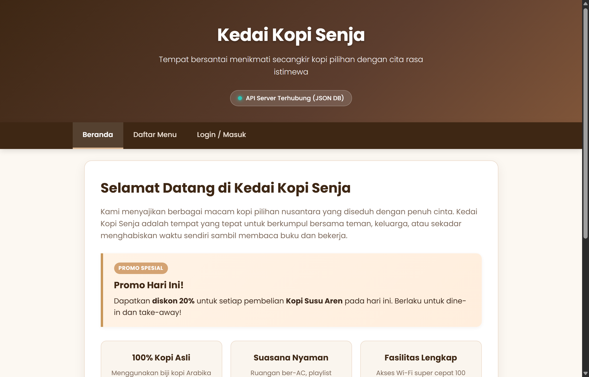
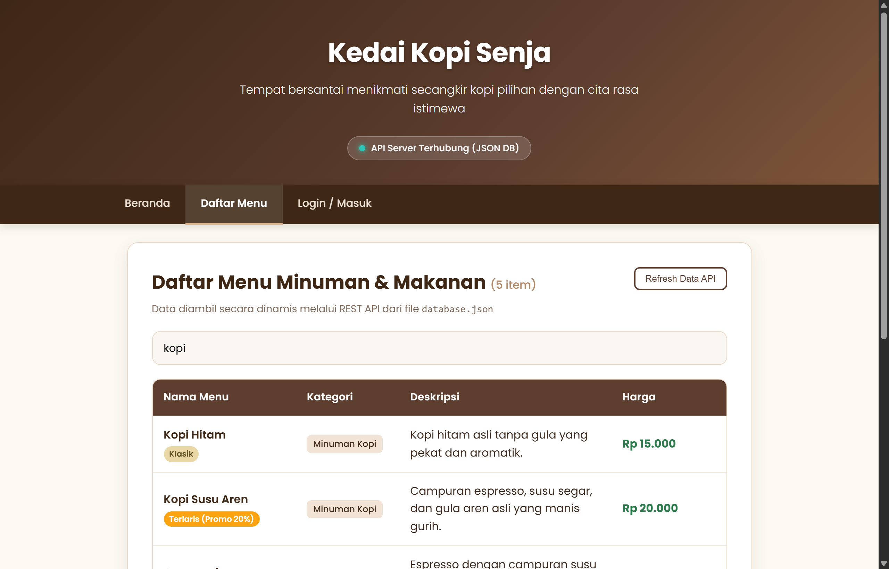
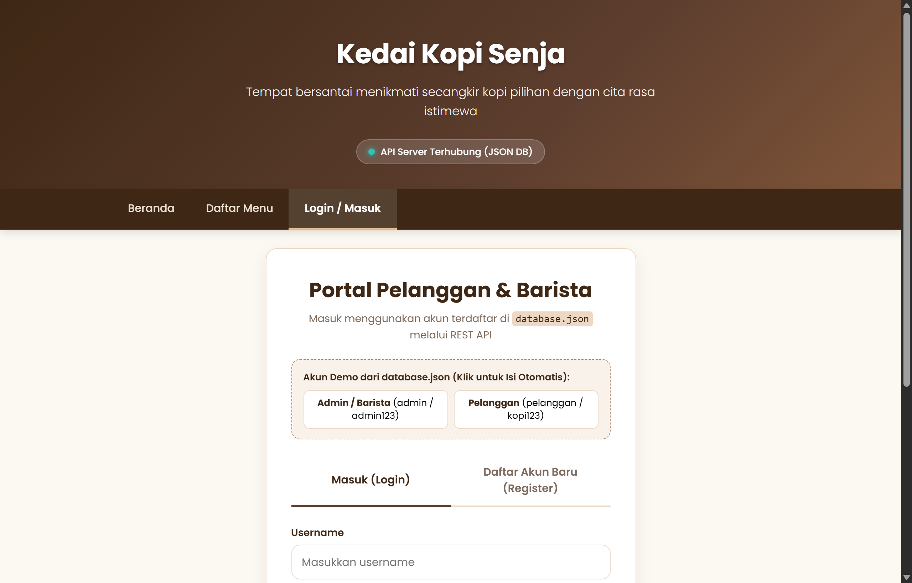
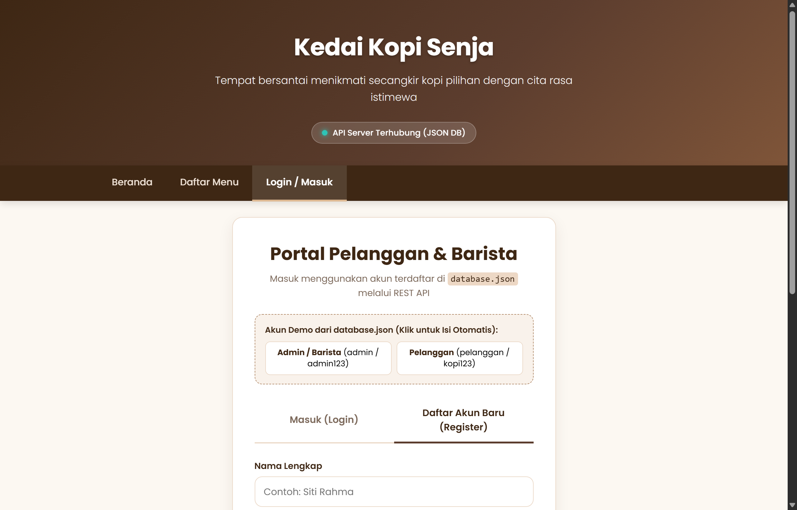
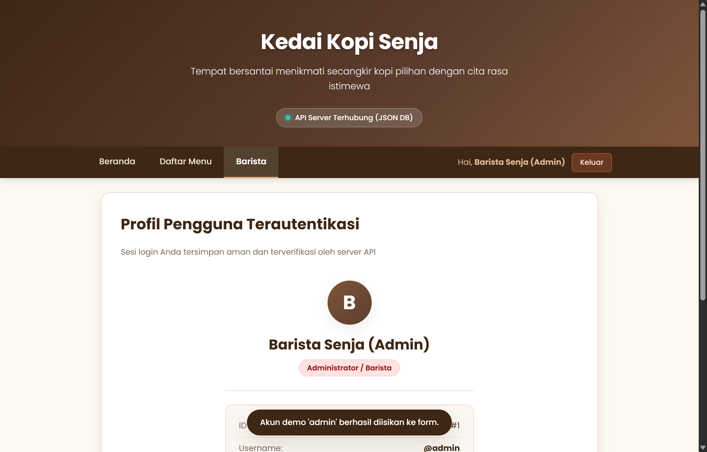
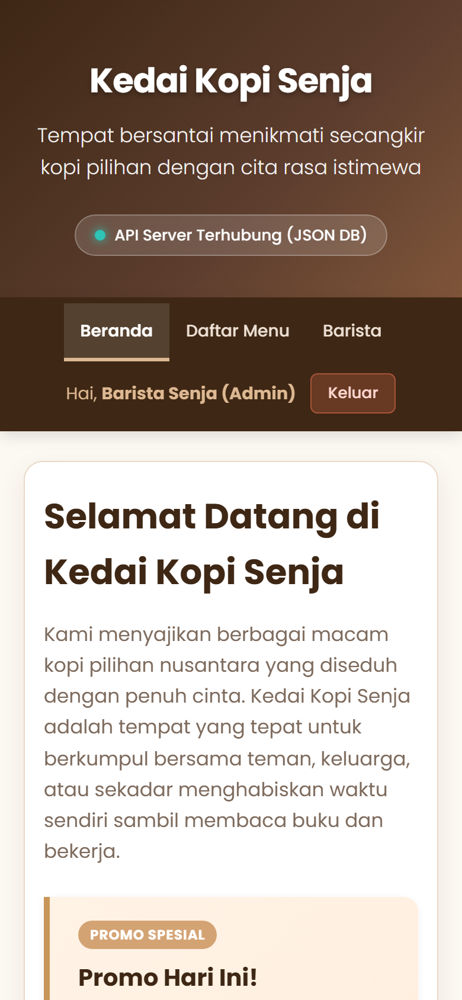

# Kedai Kopi Senja - Tugas Pemrograman Web

Aplikasi web modern untuk **Kedai Kopi Senja** yang dilengkapi dengan autentikasi Login JavaScript, REST API backend (Node.js), dan penyimpanan data menggunakan Database berbasis **JSON** (`database.json`).

---

## Fitur Utama

1. **Autentikasi Pengguna (JavaScript & REST API)**
   - Form Login (Verifikasi Username & Password via API `POST /api/login`)
   - Form Registrasi Akun Baru (Data akun baru langsung tersimpan ke `database.json` via `POST /api/register`)
   - Toggle sembunyikan/lihat password
   - Tombol cepat auto-fill akun demo (Admin & Pelanggan)
   - Penyimpanan sesi pengguna (`localStorage`) & navigasi otomatis ke halaman profil
   - Fitur Logout (Keluar akun)

2. **Database JSON (`database.json`)**
   - Menyimpan data akun pengguna (`users`) dengan peran (`role`: admin / customer)
   - Menyimpan data daftar menu minuman & makanan (`menu`) lengkap dengan kategori, deskripsi, harga, dan badge promo

3. **REST API Backend (`server.js`)**
   - Menggunakan Node.js native (`http` module tanpa ketergantungan library berat)
   - `GET /api/status` : Menampilkan status kesehatan server & koneksi database JSON
   - `GET /api/menu` : Mengambil seluruh daftar menu dari `database.json`
   - `POST /api/login` : Memvalidasi login pengguna terhadap data di `database.json`
   - `POST /api/register` : Mendaftarkan akun baru dan menyimpannya ke `database.json`
   - Melayani file statis (`index.html`, `style.css`, `app.js`)

4. **Tampilan & Desain Modern (Vanilla CSS & JavaScript)**
   - Desain bertema coffee shop hangat dengan Google Fonts (*Poppins*)
   - Responsif (ramah tampilan desktop, tablet, dan smartphone)
   - Indikator status koneksi API secara real-time
   - Fitur pencarian menu secara langsung (live search)
   - Navigasi SPA (*Single Page Application*) berbasis hash (`#home`, `#menu`, `#login`, `#profile`)

---

## Struktur File

```
tugas premograman web/
├── screenshots/         # Dokumentasi tangkapan layar tampilan aplikasi
│   ├── 01_beranda.png
│   ├── 02_daftar_menu.png
│   ├── 03_pencarian_menu.png
│   ├── 04_halaman_login.png
│   ├── 05_form_register.png
│   ├── 06_profil_pengguna.png
│   └── 07_tampilan_mobile.png
├── index.html           # Halaman utama (Beranda, Menu, Login/Register, Profil)
├── style.css            # Desain gaya tampilan modern & responsif
├── app.js               # Logika JavaScript frontend & integrasi REST API
├── server.js            # Server Backend Node.js penyedia REST API
├── database.json        # File database JSON (Users & Menu)
├── take_screenshots.js  # Script otomatis pembuat tangkapan layar (headless Chrome CDP)
├── package.json         # Konfigurasi project & script Node.js
└── README.md            # Dokumentasi aplikasi
```

---

## Dokumentasi Tampilan Aplikasi (Screenshots)

Berikut adalah dokumentasi tampilan antarmuka pengguna (*User Interface*) dari aplikasi Kedai Kopi Senja:

### 1. Halaman Beranda (Home)
Menampilkan sambutan kedai, indikator status koneksi API secara *real-time*, kotak promo spesial hari ini, kartu fitur keunggulan, jam operasional, serta tombol aksi cepat.

<p align="center">
  
</p>

---

### 2. Halaman Daftar Menu (Integrasi REST API & Database JSON)
Daftar seluruh menu kopi, non-kopi, dan camilan yang dimuat secara dinamis melalui REST API endpoint `GET /api/menu` langsung dari file `database.json`. Dilengkapi label promo/terlaris dan badge kategori.

<p align="center">
  
</p>

---

### 3. Fitur Pencarian Menu Secara Langsung (Live Search)
Fitur pencarian instan pada sisi klien (*client-side*) yang menyaring nama menu, deskripsi rasa, maupun kategori secara langsung saat pengguna mengetik.

<p align="center">
  
</p>

---

### 4. Portal Autentikasi - Form Login & Auto-Fill Demo
Formulir masuk akun yang terhubung ke endpoint `POST /api/login`. Dilengkapi tombol pintasan *auto-fill* untuk mencoba akun Admin/Barista dan Pelanggan hanya dengan satu klik, serta tombol untuk menampilkan/menyembunyikan password.

<p align="center">
  
</p>

---

### 5. Formulir Pendaftaran Akun Baru (Register)
Tab pendaftaran untuk pengguna baru. Data pengguna yang didaftarkan langsung divalidasi dan disimpan secara permanen ke file `database.json` via endpoint `POST /api/register`.

<p align="center">
  
</p>

---

### 6. Halaman Profil Pengguna (Sesi Aktif & Terverifikasi)
Tampilan kartu profil setelah pengguna berhasil login. Menampilkan inisial avatar dinamis, nama lengkap, status verifikasi database, lencana peran (*role badge* Admin / Pelanggan), serta tombol Logout yang membersihkan sesi `localStorage`.

<p align="center">
  
</p>

---

### 7. Tampilan Responsif (Mobile View)
Desain antarmuka yang sepenuhnya responsif dan nyaman digunakan pada layar perangkat *smartphone* maupun tablet.

<p align="center">
  
</p>

---

## Akun Demo Pengujian

Akun berikut telah tersedia di dalam `database.json`:

| Username | Password | Nama Pengguna | Peran (Role) |
| :--- | :--- | :--- | :--- |
| `admin` | `admin123` | Barista Senja (Admin) | Administrator |
| `pelanggan` | `kopi123` | Budi Santoso | Customer |

*Anda juga dapat mendaftarkan akun baru langsung melalui tab **Daftar Akun Baru (Register)** pada halaman web.*

---

## Cara Menjalankan Aplikasi

1. Buka terminal / command prompt pada folder proyek:
   ```bash
   cd "d:\kumpulan sistem\tugas premograman web"
   ```

2. Jalankan server Node.js:
   ```bash
   npm start
   # atau
   node server.js
   ```

3. Buka browser dan akses alamat berikut:
   ```
   http://localhost:3000
   ```
